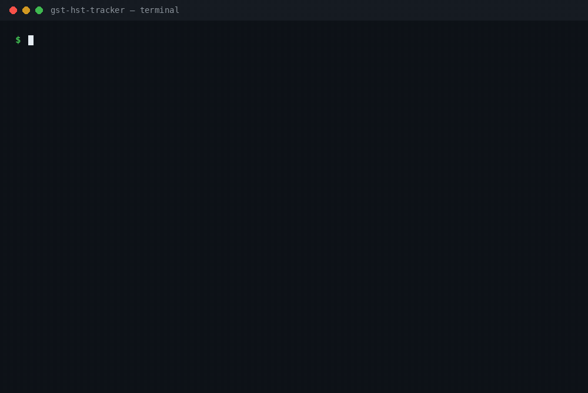

<h1 align="center">gst-hst-tracker</h1>

<p align="center"><strong>Every payment you receive has the taxman's share inside it — track what to set aside, and see the $30,000 line before you cross it.</strong></p>

<p align="center">
  
  
  
  
  
</p>



<p align="center"><em>Real runs on the bundled sample ledgers: the quarterly set-aside report, the per-province exposure view, and the threshold alarm firing at $30,001.</em></p>

GST/HST you collect is not your money. The CRA's own wording: amounts you collect are **held in trust** for the Crown until you file and remit them ([CRA, "Charge and collect the GST/HST"](https://www.canada.ca/en/revenue-agency/services/tax/businesses/topics/gst-hst-businesses/charge-collect-which-rate.html)). Spend it as income and the return deadline becomes a collections problem. And the other Canadian surprise: cross **$30,000** of taxable supplies and you stop being a small supplier — registration stops being optional, whether you noticed or not.

`gst-hst-tracker` keeps both numbers in view, from one plain ledger file you own:

- **What to set aside** — per quarter: GST/HST collected, ITCs, and **net tax owing** (collected − ITCs), with a T2125-style prep summary.
- **Where you stand** — the rolling last-four-quarters total against the $30,000 small-supplier threshold, with headroom, and an alarm (exit code 1) when you cross.
- **What each province adds** — a per-province view where Quebec's QST is a memo for Revenu Québec, and BC/Saskatchewan/Manitoba provincial tax on unrecorded sales is shown as a labelled **exposure estimate** — never blended into what you owe.

It is a **tracker, not a tax advisor**. It computes from your figures and encoded, dated rates; it never invents a tax treatment, a deadline, or an obligation. Every output carries that disclaimer, and this page states the limits up front — see [Honest limits](#honest-limits-the-short-version) before the reference material.

## Quick start

```bash
pipx install git+https://github.com/jasveerai88/gst-hst-tracker
# or: pip install git+https://github.com/jasveerai88/gst-hst-tracker

# from a clone, so the bundled examples are on disk:
gst-hst-tracker threshold examples/sample.json
```

```
gst-hst-tracker v1.0.0 — small-supplier threshold for sample.json
Rule (as of 2026-11): registration is required once taxable supplies EXCEED 30,000.00 over the last 4 calendar quarters. Exactly at the limit does not cross it.
Window: the last 4 calendar quarters ending 2026-Q2 (the quarter of the latest transaction, 2026-05-01):
  2025-Q3: 0.00
  2025-Q4: 0.00
  2026-Q1: 6,500.00
  2026-Q2: 2,500.00
Rolling 4-quarter taxable income: 9,000.00 of 30,000.00
UNDER THRESHOLD — 21,000.00 of headroom remains. You are still a small supplier on these figures.
```

Then point the three commands at your own ledger — a JSON or CSV file of payments and expenses (format below). That is the whole workflow: record, report, check the line.

## What it does

| Command | Question it answers | On the bundled samples |
|---|---|---|
| `report` | "How much of what I collected is the CRA's?" | Q1 net **556.00**, Q2 net **310.00**, total **866.00** owing on 945.00 collected |
| `threshold` | "How close am I to mandatory registration?" | 9,000.00 of 30,000.00 — **21,000.00 of headroom**; a $30,001 ledger fires the alarm, exit 1 |
| `provinces` | "What does each province's system do to these numbers?" | QC recorded QST memo **698.25** net; PST/QST **exposure estimates 799.50**, labelled, kept out of the net |

**Reference:** [Why these three numbers](#why-these-three-numbers) · [The ledger](#the-ledger) · [How the tax is computed](#how-the-tax-is-computed) · [The threshold check](#the-threshold-check) · [The provincial view](#the-provincial-view) · [Usage](#usage) · [Facts this tool relies on](#facts-this-tool-relies-on) · [For agents](#for-agents) · [Real runs](#real-runs-verbatim) · [Tests](#tests) · [Honest limits](#honest-limits-the-short-version) · [Known limits](#known-limits) · [Privacy](#privacy) · [Contributing](#contributing) · [Related](#related)

## Honest limits (the short version)

- **Exposure estimates are not amounts owing.** BC PST, Saskatchewan PST, Manitoba RST and unrecorded QST figures are `rate × sales` estimates to size your exposure. Whether that tax was collectible on a given supply depends on registration and place-of-supply facts the tool does not have.
- **Not tax advice, not a filing.** The tool prepares figures; it does not file a GST/HST return, a QST return, or anything else, and it makes no determination about your obligations. Verify with the CRA, Revenu Québec, or a qualified accountant.
- **Rates and the threshold are dated.** Defaults are stamped **as of 2026-11** and every output says so; `--rate PROV=PCT` overrides any of them. Tax law changes — Nova Scotia's HST dropped from 15% to 14% on 2025-04-01 — so check current rates before relying on the defaults.
- **Penalties and interest are not modelled.** Late-filing consequences are deliberately left to the CRA's own calculators.
- **Your ledger is taken as given.** Wrong province, wrong amount, or a tax-included total entered as pre-tax produces wrong arithmetic, faithfully computed. One row per payment is the discipline that makes the outputs mean something.

## Why these three numbers

**The set-aside.** Registrants hold collected GST/HST in trust and remit it at the end of each reporting period; the invoice date determines which period a supply belongs to ([CRA](https://www.canada.ca/en/revenue-agency/services/tax/businesses/topics/gst-hst-businesses/charge-collect-which-rate.html)). The failure mode this prevents is quiet: the tax arrives mixed into every payment, looks like income for months, and is due in a lump. The per-quarter `report` exists so the set-aside happens when the money arrives, not when the return is due.

**The $30,000 line.** Under the Excise Tax Act s.148, a person is a small supplier while their worldwide taxable supplies over the **previous four calendar quarters** do not exceed $30,000 — and exceeding $30,000 in a **single** calendar quarter ends small-supplier status immediately, before the supply that crosses ([CRA GST/HST Memorandum 2-2, "Small suppliers"](https://www.canada.ca/en/revenue-agency/services/forms-publications/publications/2-2/small-suppliers.html), ¶9, ¶11). Registration then has a deadline of its own: apply within 29 days after the effective date (¶52, Example 11). Growing freelancers cross this line mid-quarter without noticing; the `threshold` command — and its exit code, so a script or agent can catch it — exists to notice first.

**The provinces.** The rate that applies follows the **place of supply**, so one ledger can legitimately hold GST-only sales, 13% Ontario HST sales, and Quebec sales carrying QST ([CRA](https://www.canada.ca/en/revenue-agency/services/tax/businesses/topics/gst-hst-businesses/charge-collect-which-rate.html)). QST is a separate Revenu Québec tax with no ITC mechanism in this tool's federal net, and BC/SK/MB provincial taxes are separate again. The `provinces` view keeps each system in its own column instead of blending them into a number that would be wrong in both directions.

## The ledger

One JSON or CSV file. One row per payment received or expense paid:

| Field | Required | Meaning |
|---|---|---|
| `date` | yes | `YYYY-MM-DD`; must be a real calendar date |
| `kind` | yes | `income` or `expense` (case-insensitive) |
| `description` | yes | non-empty text |
| `amount` | yes | the **pre-tax** amount in CAD — never tax-included |
| `tax` | no | the GST/HST amount actually charged or paid, if you recorded it (a recorded `0` is respected — it means zero-rated) |
| `province` | yes | two-letter code; sets the default rate when `tax` is absent |
| `category` | no | expense category for the T2125-style summary |
| `qst` | no | *(provinces view; QC rows only)* the QST actually charged or paid on the row — a `qst` value on a non-QC row is rejected |

JSON shape: `{"transactions": [ ... ]}`, or a bare `[ ... ]` list. CSV uses the same field names as headers. Unknown fields are ignored; a malformed row is rejected with its row number — never guessed at.

```json
{"transactions": [
  {"date": "2026-01-15", "kind": "income",  "description": "Website build — Client A", "amount": 4000, "tax": 520, "province": "ON"},
  {"date": "2026-02-03", "kind": "expense", "description": "Laptop", "amount": 1200, "tax": 156, "province": "ON", "category": "Office expenses"}
]}
```

## How the tax is computed

- If a row records `tax`, that figure is used exactly — your invoice is the source of truth.
- If not, `amount × province rate` is computed and rounded to cents. Rates are the encoded defaults below, stamped **as of 2026-11** in every output, and any rate can be overridden: `--rate NS=14`.
- Net tax owing is **collected − ITCs**, per quarter and in total. A negative net is a refund position on the return — the tool says so, and never calls it cash in hand.
- The T2125-style summary uses gross (pre-tax) amounts; tax is tracked separately and never double-counted as income or expense.

**Encoded default GST/HST rates** (checked against CRA sources 2026-11-04 — see [Facts](#facts-this-tool-relies-on)):

| Rate | Provinces |
|---|---|
| GST 5% | AB, BC, MB, NT, NU, QC*, SK, YT |
| HST 13% | ON |
| HST 14% | NS (15% until 2025-03-31) |
| HST 15% | NB, NL, PE |

\* Quebec also has QST, handled in the provincial view.

## The threshold check

`threshold` sums **income rows only** over the last four calendar quarters ending with the quarter of your latest transaction (the window is printed, quarter by quarter), and compares against **$30,000**:

- Rolling total **at or under** $30,000 → `UNDER THRESHOLD` with the headroom, exit **0**.
- Rolling total **exceeds** $30,000 → `⚠ THRESHOLD CROSSED`, exit **1** — so a script, cron job, or agent can catch the alarm without parsing prose.
- Exactly $30,000 does **not** cross: the Act's word is *exceeds*, and the tool follows it.

The threshold counts taxable supplies. Exempt supplies are not taxable supplies — do not enter them as income (the tool prints this reminder too).

## The provincial view

`provinces` regroups the same ledger by province and keeps the systems separate:

- **GST/HST** is computed per province exactly as in `report`; the all-provinces summary sums the per-province rounded figures, so it always reconciles.
- **Quebec QST (9.975%)** is a separate Revenu Québec tax. Recorded `qst` is a **memo only — never in the net**. Sales with no recorded QST get a labelled estimate.
- **BC PST (7%), Saskatchewan PST (6%), Manitoba RST (7%)** on sales are shown as **exposure estimates**: `rate × sales`, for sizing what provincial registration and collection could mean. PST/RST paid on inputs is treated as a cost, so no provincial ITC is computed.

## Usage

```
gst-hst-tracker report    FILE [--period YYYY-Qn | YYYY] [--rate PROV=PCT ...]
                                 [--cad-to-inr RATE] [--json]
gst-hst-tracker threshold FILE [--limit AMOUNT]
                                 [--cad-to-inr RATE] [--json]
gst-hst-tracker provinces FILE [--period YYYY-Qn | YYYY] [--rate PROV=PCT ...]
                                 [--cad-to-inr RATE] [--json]
```

- `FILE` — a ledger (`.json` or `.csv`; `-` reads stdin).
- `--period YYYY-Qn` (or a bare year, `2026`) — *(report and provinces)* show one quarter or one year instead of all.
- `--rate PROV=PCT` — override a default rate for this run; repeatable.
- `--limit AMOUNT` — *(threshold only)* test against a different limit than the $30,000 default.
- `--cad-to-inr RATE` — also show figures converted at your stated rate (e.g. `--cad-to-inr 68`); the tool converts arithmetic, it never fetches or invents a rate. CAD stays the primary column.
- `--json` — one machine-readable JSON object (schema summary under [For agents](#for-agents)).
- Exit codes: `report`/`provinces` — 0 success, 2 error. `threshold` — 0 under or at the limit, **1 crossed**, 2 error. Errors are human-readable on stderr, or `{"error": ...}` under `--json`.

From a checkout, with no install: `python3 src/gst_hst_tracker.py report FILE` (Python 3.10+, standard library only).

## Facts this tool relies on

Every tax fact stated in this README, checked **2026-11-04**:

| Fact | Source |
|---|---|
| Small supplier = worldwide taxable supplies over the previous four calendar quarters not exceeding **$30,000** (public service bodies: $50,000) | CRA, GST/HST Memorandum 2-2 "Small suppliers" (June 2026), ¶9 — canada.ca |
| Exceeding $30,000 in a **single calendar quarter** ends small-supplier status immediately before the supply that crosses | Memorandum 2-2, ¶11 |
| Threshold count excludes goodwill, financial services, and capital property sales | Memorandum 2-2, ¶16 |
| Registration application due within **29 days** after the effective date of required registration | Memorandum 2-2, ¶52 and Example 11 |
| The rate follows the **place of supply**; worked examples: ON 13% HST, NS 14% HST, MB 5% GST + 7% PST | CRA, "Charge and collect the GST/HST" — canada.ca (modified 2026-04-08) |
| Collected GST/HST is **held in trust**; file and remit at the end of each reporting period; the **invoice date** determines the period | CRA, "Charge and collect the GST/HST" — canada.ca |
| Encoded rate table (GST 5%; HST 13/14/15%; QST 9.975%; BC PST 7%; SK PST 6%; MB RST 7%) | The tool's defaults, checked 2026-11-04 against CRA's published rates ("GST/HST calculator (and rates)", canada.ca); verify before filing |
| NS HST **14%** effective 2025-04-01 (was 15%) | CRA Notice 342; rate shown on CRA's charge/collect page |

What is deliberately **not** stated anywhere in this project: specific filing due dates for your reporting period (they depend on your assigned period and fiscal year — CRA publishes them; the tool's job ends at the figures), and penalties or interest amounts.

## For agents

Every command supports `--json`: exactly one object on stdout.

- `report`: common fields (`tool, version, command, file, currency, rates{... as_of: "2026-11"}, cad_to_inr, period_filter, disclaimer`), `periods[]` (each: `period, quarter, income_total, expense_total, gst_hst_collected, itcs, net_tax_owing, qst_collected, qst_paid, transactions, t2125{gross_business_income, expenses_by_category, total_expenses}`) and `totals` summing the same fields. With `--cad-to-inr`, money fields gain `*_inr` siblings.
- `threshold`: `latest_transaction, window_end_quarter, quarters[]` (four `{quarter, income}` entries, oldest first), `rolling_total, limit, headroom` (0 when crossed), `over_by` (0 when not), `crossed` (bool), `status` (`"under" | "at" | "crossed"`), `rule` — plus the exit code, which carries the verdict on its own.
- `provinces`: `provincial_rates{stamp, qst_rate_pct, taxes}`, `rounding_rule`, `provinces[]` (each: `province, tax_system, income_total, expense_total, gst_hst_collected, itcs, net_tax_owing, transactions, provincial` — null for GST-only/HST provinces, else `{name, rate_pct, recorded_collected, recorded_paid, recorded_net, estimate_base, estimated_on_sales, note}`), and `totals` (adding `qst_recorded_collected/paid/net` and `provincial_estimated_on_sales`).
- Amounts in JSON are numbers (the text output formats them to two decimals). Invalid input exits 2 with `{"error": ...}` — argparse errors included; validation errors name the row (`"row 2: ..."`).

Field rules as hard constraints: QST never enters `net_tax_owing`; provincial estimates are separate fields, never folded into owing figures; a negative net is a refund position, not cash; `status: "at"` means still a small supplier with zero headroom — never report it as crossed. The full JSON schema and agent rules live in [`SKILL.md`](SKILL.md).

## Real runs (verbatim)

Bundled sample ledger — seven rows, Ontario and Nova Scotia sales, Alberta and Ontario expenses:

```
$ gst-hst-tracker report examples/sample.json
gst-hst-tracker v1.0.0 — report for sample.json (7 transaction(s))
Tax rates: defaults as of 2026-11 — override any rate with --rate PROV=PCT (e.g. --rate NS=14).
Amounts in CAD.

2026-Q1
  Income (pre-tax): 6,500.00 · GST/HST collected: 595.00
  Expenses (pre-tax): 300.00 · ITCs (tax paid): 39.00
  NET TAX OWING: 556.00 (collected − ITCs)
  T2125-style prep: gross business income 6,500.00 · expenses — Office expenses 300.00 · total expenses 300.00

2026-Q2
  Income (pre-tax): 2,500.00 · GST/HST collected: 350.00
  Expenses (pre-tax): 800.00 · ITCs (tax paid): 40.00
  NET TAX OWING: 310.00 (collected − ITCs)
  T2125-style prep: gross business income 2,500.00 · expenses — Travel 800.00 · total expenses 800.00

TOTALS (periods shown)
  Income (pre-tax): 9,000.00 · GST/HST collected: 945.00
  Expenses (pre-tax): 1,100.00 · ITCs (tax paid): 79.00
  NET TAX OWING: 866.00 (collected − ITCs)
  T2125-style prep: gross business income 9,000.00 · expenses — Office expenses 300.00 · Travel 800.00 · total expenses 1,100.00

Net = GST/HST collected − ITCs. A negative net means ITCs exceed tax collected — a refund position on the return, not cash in hand.
Quebec: QST is a separate Revenu Québec tax and is never part of the net above; supplied QST amounts appear as memo lines only.
Disclaimer: This tool is a tracking and calculation aid only. It is not tax advice and it is not a CRA filing. Verify your figures and obligations with the CRA or a qualified accountant before filing.
```

The alarm case — $20,000 in Q1 and $10,001 in Q2 crosses by one dollar, and the exit code carries it:

```
$ gst-hst-tracker threshold examples/crossed.json; echo "exit: $?"
gst-hst-tracker v1.0.0 — small-supplier threshold for crossed.json
Rule (as of 2026-11): registration is required once taxable supplies EXCEED 30,000.00 over the last 4 calendar quarters. Exactly at the limit does not cross it.
Window: the last 4 calendar quarters ending 2026-Q2 (the quarter of the latest transaction, 2026-05-10):
  2025-Q3: 0.00
  2025-Q4: 0.00
  2026-Q1: 20,000.00
  2026-Q2: 10,001.00
Rolling 4-quarter taxable income: 30,001.00 of 30,000.00
⚠ THRESHOLD CROSSED — the rolling total exceeds 30,000.00 by 1.00. You are no longer a small supplier on these figures: GST/HST registration is required.
The window counts income (taxable supplies) only; exempt supplies are not taxable supplies and should not be entered as income.
Disclaimer: This tool is a tracking and calculation aid only. It is not tax advice and it is not a CRA filing. Verify your figures and obligations with the CRA or a qualified accountant before filing.
exit: 1
```

The provincial view on the multi-province sample (trimmed — AB and the closing notes elided; run it for the full output):

```
$ gst-hst-tracker provinces examples/provinces-sample.json
gst-hst-tracker v1.0.0 — provinces for provinces-sample.json (10 transaction(s))
Encoded rates, checked 2026-11 — verify against CRA/provincial sources before filing.
Amounts in CAD.

BC — GST 5% + PST 7%
  Sales (pre-tax): 6,000.00 · Expenses (pre-tax): 500.00
  GST/HST collected: 300.00 · ITCs: 25.00 · NET GST/HST: 275.00
  PST estimated on these sales at 7%: 420.00 — an exposure estimate, not a recorded collection; PST/RST paid on inputs is generally a cost, not an ITC, so no provincial ITC is computed.

ON — HST 13%
  Sales (pre-tax): 10,000.00 · Expenses (pre-tax): 2,000.00
  GST/HST collected: 1,300.00 · ITCs: 260.00 · NET GST/HST: 1,040.00

QC — GST 5% + QST 9.975%
  Sales (pre-tax): 10,000.00 · Expenses (pre-tax): 1,000.00
  GST/HST collected: 500.00 · ITCs: 50.00 · NET GST/HST: 450.00
  QST (memo only, NOT in the net): recorded collected 798.00 · recorded paid 99.75 · recorded net 698.25
  QST estimated on sales with no recorded QST amount (2,000.00 of sales): 199.50

SK — GST 5% + PST 6%
  Sales (pre-tax): 3,000.00 · Expenses (pre-tax): 0.00
  GST/HST collected: 150.00 · ITCs: 0.00 · NET GST/HST: 150.00
  PST estimated on these sales at 6%: 180.00 — an exposure estimate, not a recorded collection; PST/RST paid on inputs is generally a cost, not an ITC, so no provincial ITC is computed.

ALL PROVINCES (5)
  Sales (pre-tax): 33,000.00 · Expenses (pre-tax): 4,500.00
  GST/HST collected: 2,450.00 · ITCs: 385.00 · NET GST/HST: 2,065.00
  QST recorded (memo only): collected 798.00 · paid 99.75 · net 698.25
  Provincial tax estimated on sales (QST unrecorded + PST/RST): 799.50
```

## Tests

77 tests, standard library only:

```bash
python3 -m unittest discover -s tests
```

Every expected value in the suite is derived by hand from the encoded rates — the suite's header shows the full hand-worked calculation table for the provincial view, and the report and threshold fixtures are worked the same way. Covered: hand-verified arithmetic for both samples, CSV/JSON equivalence, leap-year and impossible dates, threshold boundaries (at the limit does not cross; $1 over does; the window slides), estimate-vs-recorded separation in both directions, negative-amount rejection, and `--json` shape for all three commands.

## Known limits

`report` and `threshold` fold QST into memo text only — the full QST bookkeeping lives in `provinces`. The threshold window is anchored to the calendar quarter of your latest transaction, not to today. Place-of-supply determination, exempt/zero-rated supply treatment, bad-debt adjustments, and multi-entity situations are out of scope — those are accountant questions, and the tool will not pretend otherwise.

## Privacy

The tracker runs entirely on your machine. It opens exactly the ledger file you name, computes, and prints. No network access, no telemetry, no accounts, no data leaves your computer. Your ledger — your clients, your income — never goes anywhere.

## Contributing

Issues and pull requests are welcome — see [CONTRIBUTING.md](CONTRIBUTING.md). The bar for this project: expected values in tests are worked by hand from the stated rates (never copied from the tool's own output), and any change to a tax figure needs its CRA or provincial source and check date in the change description.

## Related

- [seller-profit-truth](https://github.com/jasveerai88/seller-profit-truth) — the same honesty applied to marketplace sales: what a sale actually earned after fees, shipping, and tax.
- [payout-tracker](https://github.com/jasveerai88/payout-tracker) — know what each platform payout really is before you spend it.
- [skill-vet](https://github.com/jasveerai88/skill-vet) · [permission-audit](https://github.com/jasveerai88/permission-audit) · [worktree-janitor](https://github.com/jasveerai88/worktree-janitor) — the agent-safety side of the same toolkit.

## Who this is for

Canadian freelancers and sole proprietors who collect GST/HST (or are approaching the $30,000 line), sell across provinces, and want the set-aside number and the threshold distance from a file they control — not from a subscription, and not as a surprise in filing season.

## Support

If this tool saved you a scramble at filing time, sponsoring keeps the toolkit maintained: **[github.com/sponsors/jasveerai88](https://github.com/sponsors/jasveerai88)**.

## Licence

MIT — see [LICENSE](LICENSE).

*Not tax advice. Rates and rules as stamped; verify against the CRA and Revenu Québec before filing.*
